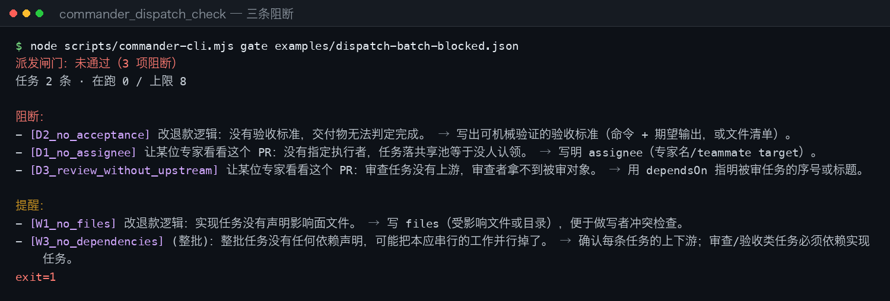
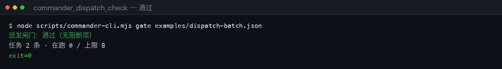
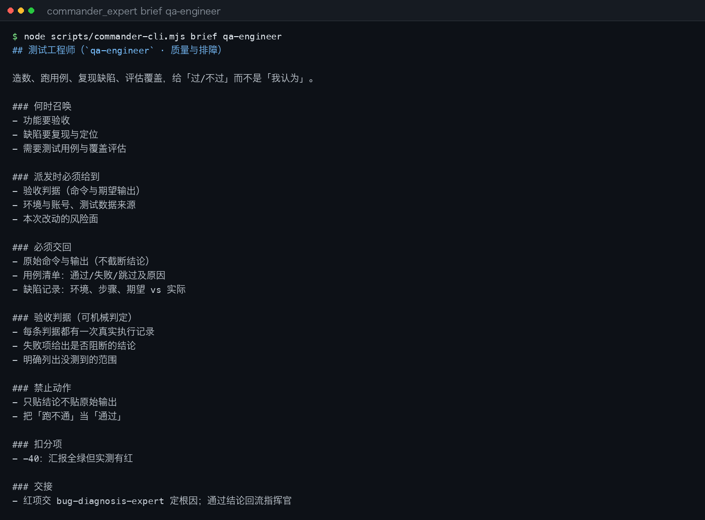
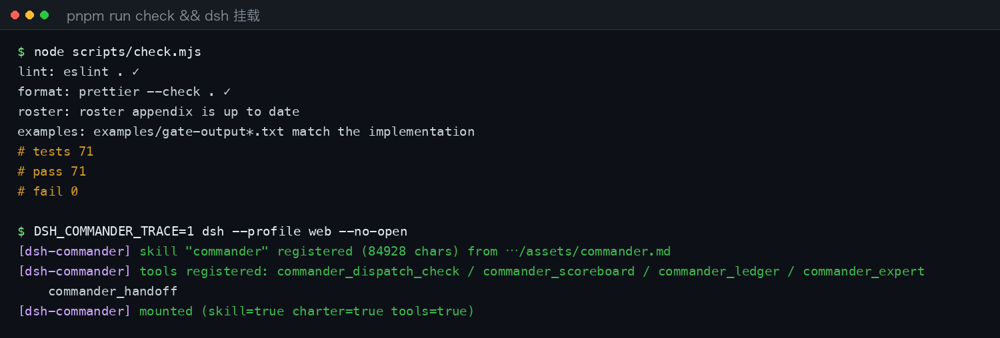

<div align="center">

# DSH Commander

**Stop treating your multi-agent playbook as a suggestion.** Expert roster, pre-dispatch gate, scoreboard and ledger — four things a Markdown skill cannot enforce, shipped as a DeepSeek Harness plugin.

[](#compatibility)
[](#compatibility)
[](https://nodejs.org/)
[](https://github.com/coding-today/dsh-commander/actions/workflows/ci.yml)
[](https://github.com/coding-today/dsh-commander/actions/workflows/ci.yml)
[](LICENSE)

[中文](./README.md) ｜ [English](./README.en.md)

</div>

---

## What this is

A DeepSeek Harness plugin that installs the _commander_ methodology for multi-expert work into the host itself, instead of leaving it in a Markdown skill the model may or may not load.

After installing you get four things:

- **An always-on charter** (~1.7k chars) injected into the system prompt — present in every session
- **A playbook skill** (`commander`, ~84.7k chars) with the roster, the seven-phase workflow and field lessons
- **A 19-expert roster** where every expert carries seven requirements (when to summon / what you must provide / what they must return / acceptance criteria / forbidden moves / penalties / handoff)
- **Five tools** — pre-dispatch gate, roster lookup, expert handoff, expert scoreboard, lessons ledger

It does not think for you and does not dispatch for you. It puts a checkpoint before dispatch and after handoff, so "sent, returned, judged" leaves evidence that can be re-checked later.

**Contents:** [Problem](#the-problem) · [Screenshots](#screenshots) · [Quick start](#quick-start) ·
[Tools](#the-four-tools) · [Roster](#expert-roster-19) · [CLI](#verify-without-installing) · [Configuration](#configuration) ·
[Non-goals](#non-goals) · [FAQ](#faq) · [Compatibility](#compatibility) · [Repository layout](#repository-layout)

---

## The problem

The usual failure in multi-agent work is not "the model is not smart enough" — it is that **dispatched work cannot be accepted or rejected**. A vague instruction lets every subagent improvise, and you end up with a pile of "done" you cannot check.

| What people say                                | Without the gate                                                       | With the gate                                                               |
| ---------------------------------------------- | ---------------------------------------------------------------------- | --------------------------------------------------------------------------- |
| "Have some expert look at this PR"             | Lands in the shared pool, nobody claims it, discovered two hours later | `D1_no_assignee` blocks: name the assignee                                  |
| "Refactor the refund logic, tell me when done" | The deliverable cannot be judged complete                              | `D2_no_acceptance` blocks: command + expected output, or a file list        |
| "Review the code he just wrote"                | The reviewer has no upstream artifact and reviews from thin air        | `D3_review_without_upstream` blocks: point `dependsOn` at the upstream task |
| "You write it, then check it yourself"         | The same expert implements and self-reviews → no review at all         | `D4_self_review` blocks: reviews need a different assignee                  |
| "Run all of these at once"                     | Twelve subagents at once, everything stalls                            | `D5_over_concurrency` blocks: above the cap                                 |
| "Find an expert for this"                      | The name does not exist; the model improvises a persona                | `D6_unknown_expert` blocks: not in the roster                               |
| "Who did well this round?"                     | Lives only in chat history; next round starts from zero                | Scoreboard on disk, every adjustment carries a reason                       |

## Screenshots

**1. The gate actually blocks** — three blocking items, two warnings, each with a fix.



**2. A clean pass** — `gate` exits 0, so it can sit in CI untouched.



**3. Fetch an expert's requirements before dispatch** — `brief` prints the seven sections to paste into the task.



**4. Self-check and a real mount** — `node scripts/check.mjs` is green; `DSH_COMMANDER_TRACE=1` prints three mount lines.



> These images are **transcription renders of real command output**: the sources live in
> `docs/screenshots/src/*.txt`, captured from actual runs, and `python3 scripts/render-screenshots.py`
> draws them in terminal style. Change the output, re-render, and the difference shows up in the diff.

## Quick start

```bash
# 1) Install the plugin's own dependencies (pnpm's link: install will NOT do this)
cd ~/.dsh/local-plugins/dsh-commander && pnpm install

# 2) Add it to the web profile
dsh plugin --profile web add ~/.dsh/local-plugins/dsh-commander

# 3) Restart DSH (plugins mount at boot)
```

Then verify — all three mount lines must appear:

```bash
DSH_COMMANDER_TRACE=1 dsh --profile web --no-open 2>&1 | grep dsh-commander
# [dsh-commander] skill "commander" registered (83751 chars) from …/assets/commander.md
# [dsh-commander] tools registered: commander_dispatch_check / commander_scoreboard / commander_ledger / commander_expert
# [dsh-commander] mounted (skill=true charter=true tools=true)
```

Day-to-day rhythm inside a session:

```text
1. You: "commanders, split this work"          → skill + always-on charter load
2. It calls commander_dispatch_check           → fix assignee / acceptance / dependsOn until it passes
3. It calls commander_expert brief <slug>      → paste the seven requirements into the task
4. On handover: commander_handoff              → note lands in .agent/plans/handoffs/
5. On completion: commander_scoreboard adjust  → score with a written reason
6. Wrap-up: commander_ledger                   → record what worked and what bit
```

### Verify without installing

The CLI runs the same logic (`gate` exits 1 when blocked, so it is CI-ready):

```bash
node scripts/commander-cli.mjs gate examples/dispatch-batch-blocked.json
node scripts/commander-cli.mjs gate examples/dispatch-batch.json
node scripts/commander-cli.mjs brief qa-engineer
node scripts/commander-cli.mjs experts quality
```

## The four tools

### `commander_dispatch_check` — the pre-dispatch gate

| Parameter        | Type    | Description                                        |
| ---------------- | ------- | -------------------------------------------------- |
| `tasks`          | array   | Tasks to dispatch (fields below)                   |
| `running`        | integer | Subagents already running, default 0               |
| `maxConcurrency` | integer | Concurrency cap, defaults to the plugin config (8) |

Task fields: `subject` (required), `assignee`, `expert` (roster slug), `role`
(`impl`/`review`/`qa`/`doc`/`research`), `acceptance`, `files`, `dependsOn` (task number, **1-based**, or a subject), `running`.

Blocking codes: `D1_no_assignee`, `D2_no_acceptance`, `D3_review_without_upstream`, `D4_self_review`,
`D5_over_concurrency`, `D6_unknown_expert`, `D7_unknown_peer` (a `peers` entry outside the roster).
Warning codes: `W1_no_files`, `W2_write_conflict`, `W3_no_dependencies`, `W4_no_expert`.

### `commander_expert` — the roster

`action: list` (filter by division) ｜ `brief` (seven requirements for one expert) ｜ `divisions`.

### `commander_handoff` — handoffs between experts

`create` (write the note) ｜ `read` (fetch it). Parameters: `task`, `from`, `to` (roster slugs),
`summary` (one-line conclusion; empty is rejected), `evidence`, `openItems`, `asks`, `at`.
Writes `.agent/plans/handoffs/<task>--<from>-to-<to>.md` and returns a **message body ready to paste into
`send_message` / `agent_teams_send_message`** — delivery belongs to the host; the note owns the content and evidence.

Add `deliver: true` + `toMember: "<teammate|captain>"` to skip the manual paste: the plugin calls the host's
`agent_teams_send_message` and the message lands in the recipient's inbox, with the receipt reporting
`live / wake / mailbox / duplicate`. **`from` is assigned by the host from the caller's identity** — neither the
plugin nor the model may sign as an expert; without a team the tool refuses and tells you to paste instead.

### `commander_scoreboard` — expert scoring

`init` (needs `task` + `experts`) ｜ `adjust` (needs a reason) ｜ `show`.
Writes `.agent/plans/<task>-expert-scoreboard.md`. Starts at 100; a single adjustment is capped at ±100;
the running total is not clamped.

### `commander_ledger` — lessons ledger

Appends "what worked / what bit / rule to keep" to `.agent/plans/commander-ledger.md`, newest on top;
rotates to `commander-ledger-YYYYMM.md` past 256 KiB.

## Expert roster (19)

| Division     | Experts                                                                               |
| ------------ | ------------------------------------------------------------------------------------- |
| Product      | `prd-expert`                                                                          |
| Design       | `ux-expert`, `ux-auditor`                                                             |
| Engineering  | `fullstack-arch`, `frontend-developer`, `devops-sre`                                  |
| Quality      | `qa-engineer`, `bug-diagnosis-expert`, `code-review-expert`, `critical-code-reviewer` |
| Security     | `sec-auditor`                                                                         |
| Data         | `data-analyst`                                                                        |
| Operations   | `ops-expert`                                                                          |
| Research     | `research-expert`                                                                     |
| Docs         | `skill-creator`                                                                       |
| Localization | `i18n-ja-reviewer`, `i18n-ko-reviewer`, `i18n-es-reviewer`, `i18n-pt-br-reviewer`     |

All seven requirements for every expert live in `lib/experts.js` (single source) and are mirrored into the
skill appendix by `pnpm run roster`. Read one: `node scripts/commander-cli.mjs brief sec-auditor`.

## Configuration

Set in the profile's `cordis.patch.yml`:

| Key                | Default               | Meaning                                              |
| ------------------ | --------------------- | ---------------------------------------------------- |
| `skillName`        | `commander`           | Skill name to register                               |
| `registerSkill`    | `true`                | Register the playbook skill                          |
| `promptSection`    | `true`                | Inject the charter section                           |
| `promptOrder`      | `118`                 | Charter order (after 0, before host PLAN_POLICY 500) |
| `tools`            | `true`                | Register the four tools                              |
| `plansDir`         | `.agent/plans`        | Scoreboard and ledger directory (workspace-relative) |
| `ledgerFile`       | `commander-ledger.md` | Ledger file name (no directories)                    |
| `maxConcurrency`   | `8`                   | Shared by the charter text and the gate              |
| `skillDescription` | built in              | Skill description for the catalog                    |

`plansDir` / `ledgerFile` are allow-list validated: absolute paths, `~` and `..` are rejected and the
default is used with a warning. All writes go through the host's `ctx.fs`, so **a read-only session cannot
write at all** — that is deliberate; the tools never bypass session permissions.

## Non-goals

- **Not an auto-dispatcher.** The gate answers "can this batch be dispatched"; the model still dispatches.
- **Does not decide for experts.** Requirements live in the roster; professional calls stay with experts.
- **Does not guarantee quality.** It guarantees "no dispatch without acceptance criteria", not "correct".
- **No network, no shell.** Apart from the two ledger files it writes nothing.

## FAQ

**1. Why restart DSH?** Plugins mount at boot (`dsh.bundle.patch`), so installing or editing code needs a restart.

**2. `ERR_MODULE_NOT_FOUND Cannot find package '@deepseek-ai/schemastery'` at boot?**
`dsh plugin add` uses pnpm's `link:`, which does not install the target's dependencies. Run `pnpm install`
inside the plugin directory first.

**3. Install refused with `incompatible with dsh …`?** The version gate reads `engines.dsh`. Bump the
lower bound after upgrading DSH, or pass `--accept-risk` (recorded in the profile).

**4. My existing `~/.dsh/skills/commander.md` stopped winning.**
Skill precedence is `project > runtime > user`; the plugin's runtime skill overrides the user-level
same-name skill. Edit `lib/experts.js` and run `pnpm run roster` to change the roster.

**5. How do experts talk to each other?** Delivery is a host capability (`send_message` /
`agent_teams_send_message`); this plugin does not take over transport and never impersonates an expert. It owns
the _discipline_ and the handover content: a task book must list `peers` to allow lateral contact
(unknown → `D7_unknown_peer`), a handover must produce a `commander_handoff` note (which can `deliver: true`
straight into a teammate's inbox), anything unlisted goes through the commander, and there is exactly one
source of external conclusions.

**6. What happens if I score in a read-only session?** The sandbox rejects the write and the tool returns an
error. There is no write path that bypasses session permissions.

**7. `brief` says it matches several experts.** Matching accepts slug, full name or substring, but only a
unique hit is returned. Fragments like `expert` match six — use the full slug.

**8. `DSH_COMMANDER_TRACE=1` shows nothing?** The host filters `logger.info` during boot, so this plugin
writes traces straight to stderr. Make sure your command has `2>&1 | grep dsh-commander`.

**9. How do I add my own expert?** Add one entry in `lib/experts.js` (seven sections, penalty scale
`-15/-20/-25/-40`) → `pnpm run roster` → `pnpm test` → restart. The gate recognises the new slug automatically.

## Compatibility

| Item             | Version                                                         |
| ---------------- | --------------------------------------------------------------- |
| DeepSeek Harness | Tested on **0.2.1-rc.2**; `engines.dsh` requires `>=0.2.1-rc.2` |
| Node.js          | `>=22.19.0` (CI runs 22.22.3)                                   |
| Platform         | macOS tested; Linux expected to work; Windows untested          |

> `engines.dsh` has no upper bound: passing the gate is not the same as being tested. After a host major
> upgrade, re-run `node scripts/check.mjs` and confirm one real mount with `DSH_COMMANDER_TRACE=1`.

## Repository layout

```text
dsh-commander/
├── lib/
│   ├── index.js        # apply: skill registration, charter, four tools
│   ├── defaults.js     # single source for dirs, file names, cap, error prefix
│   ├── charter.js      # always-on charter text
│   ├── experts.js      # 19 experts with seven requirements (single source)
│   ├── handoff.js      # handoff notes and their message body
│   ├── dispatch.js     # dispatch gate (pure functions)
│   ├── scoreboard.js   # scoreboard markdown build/parse
│   ├── ledger.js       # ledger insertion and rotation
│   └── workspace.js    # path allow-list + host fs read/write
├── assets/commander.md # playbook skill (roster appendix is generated)
├── scripts/            # roster renderer, example regen, CLI, screenshots, one-command check
├── test/               # 71 cases (node --test)
├── examples/           # runnable batches with real gate output
├── docs/screenshots/   # README images and their real source transcripts
├── .github/            # CI, issue and PR templates
└── cordis.patch.yml    # profile mount entry
```

## Development

```bash
pnpm install
pnpm run check       # lint → format → roster → examples → test (same command CI runs)
pnpm run roster      # regenerate the roster appendix after editing lib/experts.js
pnpm run screenshots # re-render images after editing docs/screenshots/src/*.txt
```

Conventions live in [CONTRIBUTING.md](./CONTRIBUTING.md): code and JSDoc in English, user-facing copy in
Chinese. The six invariants you must know before touching code are in [AGENTS.md](./AGENTS.md).
Security reports: [SECURITY.md](./SECURITY.md).

## License

[MIT](./LICENSE) © 2026 Yuxiang Lin
